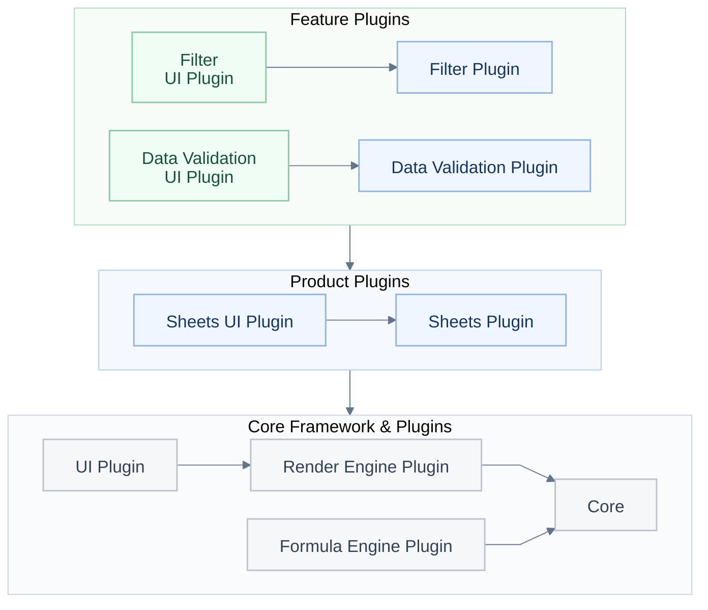
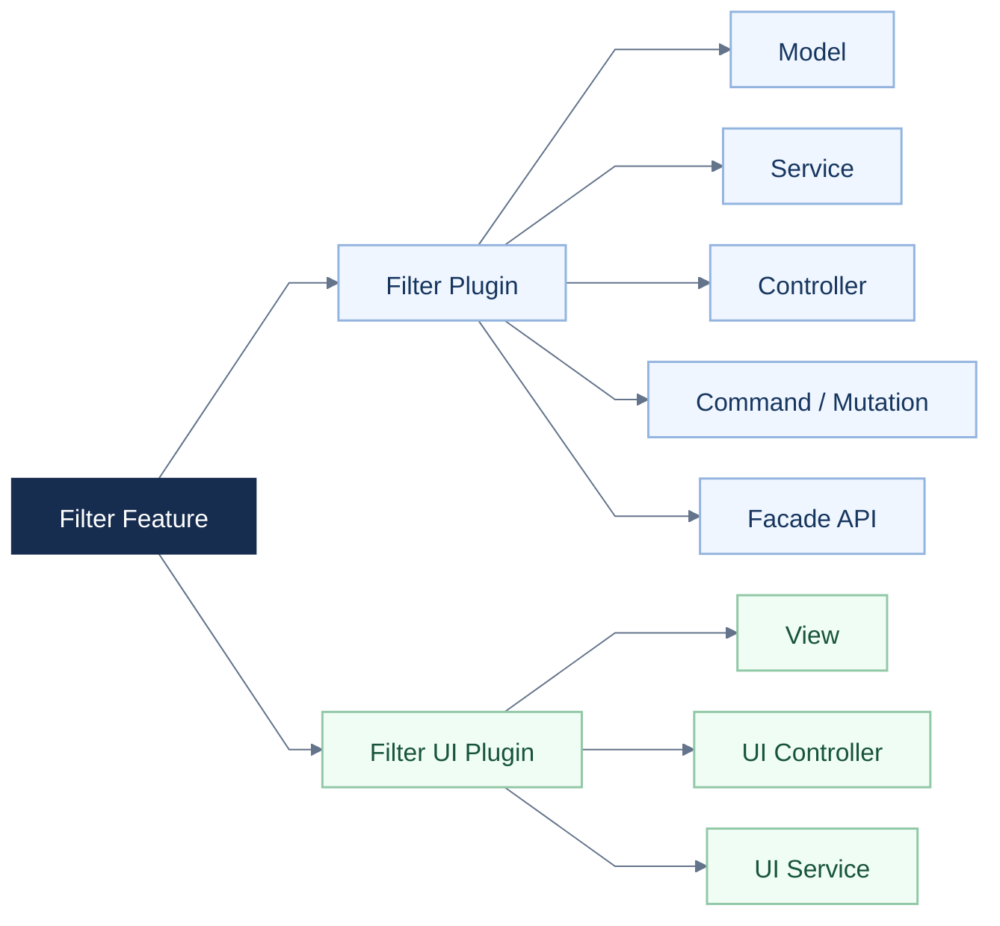
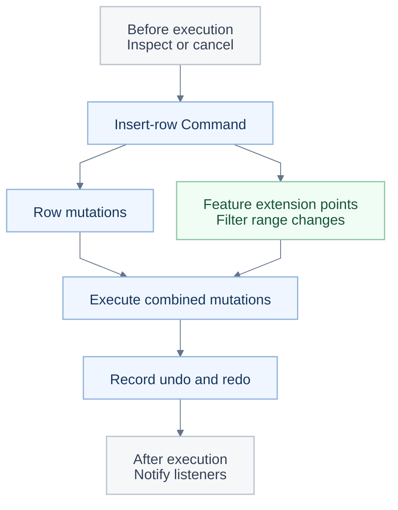

# GitHub Trending: dream-num/univer

- URL: https://github.com/dream-num/univer

- Stars: 24,293

- Today: TypeScript

- Language: any

- Description: Build your own AI office with Univer Office SDK. Bring editing, calculation, collaboration, and file processing into your product for people and AI agents. Built on an extensible open-source core.


--- README 原文 ---
<a id="readme-top"></a>

<p align="center"></p>

<h1 align="center">Build your own AI office with Univer Office SDK.</h1>

<p align="center">Start with open-source Sheets and Docs, then connect your own application or agent.</p>

<p align="center"><a href="#quick-start">🚀 Quick start</a> · <a href="https://docs.univer.ai/">📚 Documentation</a> · <a href="https://univer.ai/compare/">⚖️ Feature comparison</a> · <a href="https://univer.ai/">🌐 Website</a> · <a href="https://docs.univer.ai/showcase">🎮 Showcase</a> · <a href="https://docs.univer.ai/reference/classes/univer">🔧 API Reference</a> · <a href="https://docs.univer.ai/blog">📝 Blog</a></p>

<p align="center"><strong>English</strong> · <a href="./docs/readme/fr-FR.md">Français</a> · <a href="./docs/readme/de-DE.md">Deutsch</a> · <a href="./docs/readme/es-ES.md">Español</a> · <a href="./docs/readme/zh-CN.md">简体中文</a> · <a href="./docs/readme/zh-TW.md">繁體中文</a> · <a href="./docs/readme/ja-JP.md">日本語</a> · <a href="./docs/readme/ko-KR.md">한국어</a></p>

<p align="center">
  <a href="https://github.com/dream-num/univer/releases"></a>
  <a href="./LICENSE"></a>
  <a href="https://github.com/dream-num/univer/actions/workflows/build-packages.yml"></a>
  <a href="https://www.codefactor.io/repository/github/dream-num/univer/overview/dev"></a>
  <a href="https://codecov.io/gh/dream-num/univer"></a>
</p>

<p align="center">
  <a href="https://github.com/dream-num/univer"></a>
  <a href="https://github.com/dream-num/univer/graphs/contributors"></a>
  <a href="https://github.com/dream-num/univer/issues"></a>
  <a href="https://github.com/dream-num/univer/commits/dev/"></a>
</p>

<p align="center">
  <a href="https://discord.gg/z3NKNT6D2f"></a>
  <a href="https://twitter.com/univerhq"></a>
  <a href="https://opencollective.com/univer"></a>
</p>

<p align="center">
  <a href="https://trendshift.io/repositories/4376"></a>
</p>

<details>
<summary>Table of contents</summary>

- [💡 What is Univer?](#what-is-univer)
  - [Open-source capabilities](#open-source-capabilities)
- [🚀 Build on the open-source foundation](#what-you-can-build)
  - [Quick start: an open-source spreadsheet editor](#quick-start)
  - [Connect your application to editable content](#connect-your-application-to-editable-content)
- [🏗️ Explore the open-source architecture](#open-source-architecture)
  - [Give custom features clear boundaries](#give-custom-features-clear-boundaries)
  - [Compose cross-feature edits and undo/redo](#compose-cross-feature-edits-and-undoredo)
  - [Connect applications and agents through Facade APIs and events](#connect-applications-and-agents-through-facade-apis-and-events)
- [🧩 Extend your application with Univer Office SDK](#open-source-and-commercial-extensions)
  - [Scope and licensing](#scope-and-licensing)
- [🌐 Application patterns and ecosystem](#application-patterns-and-ecosystem)
  - [Univer Workspace: an Office SDK reference application](#univer-workspace-an-office-sdk-reference-application)
  - [CLI, agent integrations, and developer skills](#cli-agent-integrations-and-developer-skills)
- [📚 Documentation and contributing](#documentation-and-contributing)
  - [Runtime compatibility](#runtime-compatibility)
- [💬 Community](#community)
- [🔒 Security](#security)
- [❤️ Sponsors](#sponsors)
- [📄 License](#license)

</details>

<a id="what-is-univer"></a>

## 💡 What is Univer?

<p align="center"></p>

**Univer** is an Office SDK for building Office applications inside your own product. It provides Office editing, calculation, collaboration, and file processing for people and existing agents, using your data and permissions. The product family covers spreadsheets, documents, presentations, relational tables, canvases, and PDFs.

Univer Office SDK has three parts:

- **Web SDK** is the foundation: content models, editing, rendering, formula calculation, and Facade APIs (application-facing APIs). Compose its plugins into an embedded editor or your own Office application, and reuse the content models, commands, and calculation for Headless processing without an interactive editor.
- **Server SDK** adds backend services for real-time collaboration, edit history, and Office file import and export.
- **AI SDK** connects Office capabilities to existing agents and workflows, with content tools, execution, and review integrations.

**This repository provides the Web SDK's core architecture and engine implementations under Apache-2.0**: content models and snapshot formats, plugin and dependency management, the command system, formula and rendering engines, Facade APIs, UI foundation, and Sheets and Docs editing capabilities. Commercial Web SDK plugins, Server SDK, and commercial AI SDK extensions are distributed and licensed separately.

Agents can use the same open-source APIs; your application supplies the model and tool orchestration. The [quotation example](#connect-your-application-to-editable-content) demonstrates editing, calculation, and saving without an AI SDK dependency.

<a id="open-source-capabilities"></a>

### Open-source capabilities

<div align="center" style="overflow-x: auto;">

<table align="center" style="display: table; width: auto; margin-left: auto; margin-right: auto;">
<thead>
<tr>
<th>Area</th>
<th>Selected capabilities</th>
</tr>
</thead>
<tbody>
<tr>
<td><strong>Sheets · Editing and layout</strong></td>
<td>Cell styles, merged cells, in-cell rich text, freeze panes, floating images, and undo/redo.</td>
</tr>
<tr>
<td><strong>Sheets · Data and calculation</strong></td>
<td>Formulas, defined names, filtering, sorting, data validation, conditional formatting, hyperlinks, comments, and find and replace.</td>
</tr>
<tr>
<td><strong>Docs</strong></td>
<td>Rich-text editing, paragraph formatting, lists, hyperlinks, comments, and drawing integration.</td>
</tr>
</tbody>
</table>

</div>

Features are composed through plugins and presets; the [quick start](#quick-start) uses only the **Sheets Core preset**. Images use the corresponding drawing plugins. See the [feature comparison](https://univer.ai/compare/) for detailed open-source and commercial coverage.

The demos below showcase the wider **Univer Office SDK**, including commercial capabilities. They show more than the default open-source setup; see [open source and commercial extensions](#open-source-and-commercial-extensions) for scope.

<div align="center" style="overflow-x: auto;">

<table align="center" style="display: table; width: auto; margin-left: auto; margin-right: auto;">
<tbody>
<tr>
  <td width="50%"><a href="https://univer.ai/demo/spreadsheets"></a></td>
  <td width="50%"><a href="https://univer.ai/demo/docs"></a></td>
</tr>
<tr>
  <td width="50%"><a href="https://univer.ai/demo/web-app"></a></td>
  <td width="50%"><a href="https://univer.ai/demo/universe"></a></td>
</tr>
<tr>
  <td width="50%"><a href="https://univer.ai/demo/slides"></a></td>
  <td width="50%"><a href="https://univer.ai/demo/relational-tables"></a></td>
</tr>
<tr>
  <td width="50%"><a href="https://univer.ai/demo/canvases"></a></td>
  <td width="50%"><a href="https://univer.ai/demo/pdf"></a></td>
</tr>
</tbody>
</table>

</div>

<p align="right"><a href="#readme-top"></a></p>

<a id="what-you-can-build"></a>

## 🚀 Build on the open-source foundation

<p align="center"></p>

<div align="center" style="overflow-x: auto;">

<table align="center" style="display: table; width: auto; margin-left: auto; margin-right: auto;">
<thead>
<tr>
<th>Your goal</th>
<th>Use the open-source foundation</th>
<th>Start here</th>
</tr>
</thead>
<tbody>
<tr>
<td><strong>Embed Sheets or Docs</strong></td>
<td>Add an editable Office surface to your application or agent product, and connect your data through Facade APIs.</td>
<td><a href="#quick-start">Quick start</a></td>
</tr>
<tr>
<td><strong>Process content without an editor</strong></td>
<td>Reuse content plugins, models, commands, and calculation in Node.js for editing, snapshots, and automated tasks.</td>
<td><a href="https://docs.univer.ai/guides/sheets/getting-started/node">Headless guide</a></td>
</tr>
<tr>
<td><strong>Develop custom features or editors</strong></td>
<td>Reuse the engines, UI components, plugin boundaries, dependency injection, and command/undo systems. Follow existing features to extend Sheets and Docs or develop your own editors.</td>
<td><a href="#open-source-architecture">Open-source architecture</a></td>
</tr>
</tbody>
</table>

</div>

**Coordinate edits and undo/redo across features.** Inserting a row inside a filter range changes both the base content and the filter range; undo needs to restore both. Each feature supplies its own changes and undo data, and the command composes their execution and history. The architecture walkthrough explains how to extend these editing workflows.

<a id="quick-start"></a>

### Quick start: an open-source spreadsheet editor

In a browser application using a bundler such as Vite:

```bash
pnpm add @univerjs/presets @univerjs/preset-sheets-core
```

Create the container before initializing Univer:

```html
<div id="app" style="height: 100vh"></div>
```

```ts
import { UniverSheetsCorePreset } from '@univerjs/preset-sheets-core'
import UniverPresetSheetsCoreEnUS from '@univerjs/preset-sheets-core/locales/en-US'
import { createUniver, LocaleType, mergeLocales } from '@univerjs/presets'
import '@univerjs/preset-sheets-core/lib/index.css'

const { univerAPI } = createUniver({
  locale: LocaleType.EN_US,
  locales: {
    [LocaleType.EN_US]: mergeLocales(UniverPresetSheetsCoreEnUS),
  },
  presets: [
    UniverSheetsCorePreset({
      container: 'app',
    }),
  ],
})

univerAPI.createWorkbook({})
```

Your page now contains a spreadsheet editor. Use the returned `univerAPI` to work with its content. This example uses open-source packages and needs no commercial Univer license or Server SDK.

For component frameworks, retain the `univer` instance returned by `createUniver` and call `univer.dispose()` when the component unmounts. See the [lifecycle guide](https://docs.univer.ai/guides/sheets/getting-started/lifecycle).

Presets compose plugins and register their Facade APIs. For manual control, see the [Plugin Mode example](#manual-plugin-composition) below. The [installation guide](https://docs.univer.ai/guides/sheets/getting-started/installation) covers both modes, peer dependencies, and framework integrations.

Keep coordinated `@univerjs/*` packages on the same version. Commercial packages must use the matching release line; independently released packages such as icons follow their declared compatibility. See the [API Stability Policy](./docs/API_STABILITY.md).

<a id="connect-your-application-to-editable-content"></a>

### Connect your application to editable content

Facade APIs are the application-facing interface to workbooks, worksheets, and ranges. Continue from the quick start to populate a quotation, update a quantity from application code, and read the recalculated total:

```ts
// Wait for formula controllers before editing a newly created workbook.
await new Promise<void>((resolve) => {
  if (univerAPI.getCurrentLifecycleStage() >= univerAPI.Enum.LifecycleStages.Steady) {
    resolve()
    return
  }
  const listener = univerAPI.addEvent(univerAPI.Event.LifeCycleChanged, ({ stage }) => {
    if (stage === univerAPI.Enum.LifecycleStages.Steady) {
      listener.dispose()
      resolve()
    }
  })
})

const workbook = univerAPI.getActiveWorkbook()!
const sheet = workbook.getActiveSheet()

sheet.getRange('A1:D4').setValues([
  ['Item', 'Quantity', 'Unit price', 'Amount'],
  ['Seats', 2, 25, '=B2*C2'],
  ['Support', 1, 100, '=B3*C3'],
  ['Total', '', '', '=SUM(D2:D3)'],
])

// An application control or agent can make the same edit.
sheet.getRange('B2').setValue(4)

univerAPI.getFormula().onCalculationResultApplied().then(() => {
  console.log(sheet.getRange('D4').getValue()) // 200
  localStorage.setItem('quotation', JSON.stringify(workbook.save()))
}).catch(console.error)
```

The editor and your application operate on the same workbook; formula changes are recalculated automatically. `workbook.save()` returns a JSON snapshot containing the workbook and its registered plugin data. Your application owns persistence; this example uses browser storage. On a later page load, after initialization, restore the snapshot **instead of creating a blank workbook**:

```ts
const saved = localStorage.getItem('quotation')
if (saved) {
  univerAPI.createWorkbook(JSON.parse(saved))
}
```

This workflow uses only open-source packages. Snapshot persistence is separate from XLSX import and export, which uses the separately distributed file-conversion capabilities. Use public Facade APIs for application integration; the source links below explain internal implementation and extension points. See the [API Stability Policy](./docs/API_STABILITY.md) before depending on an extension point.

<a id="manual-plugin-composition"></a>

<details>
<summary>Advanced: compose plugins manually (Plugin Mode)</summary>

Use Plugin Mode when you need precise control over plugin selection, dependencies, or loading. The preset above handles this composition for you.

This alternative initialization uses the same `app` container and the Sheets Core preset's browser plugin stack without a Worker. Use it **instead of** the preset initialization, then run the same quotation example with the returned `univerAPI`.

```bash
pnpm add @univerjs/core @univerjs/design @univerjs/docs @univerjs/docs-ui \
  @univerjs/engine-formula @univerjs/engine-render @univerjs/network \
  @univerjs/sheets @univerjs/sheets-ui @univerjs/sheets-formula \
  @univerjs/sheets-formula-ui @univerjs/sheets-numfmt \
  @univerjs/sheets-numfmt-ui @univerjs/ui
```

```ts
import { LocaleType, mergeLocales, Univer } from '@univerjs/core'
import { FUniver } from '@univerjs/core/facade'
import DesignEnUS from '@univerjs/design/locale/en-US'
import { UniverDocsPlugin } from '@univerjs/docs'
import { UniverDocsUIPlugin } from '@univerjs/docs-ui'
import DocsUIEnUS from '@univerjs/docs-ui/locale/en-US'
import { UniverFormulaEnginePlugin } from '@univerjs/engine-formula'
import FormulaEnUS from '@univerjs/engine-formula/locale/en-US'
import { UniverRenderEnginePlugin } from '@univerjs/engine-render'
import { UniverNetworkPlugin } from '@univerjs/network'
import { UniverSheetsPlugin } from '@univerjs/sheets'
import SheetsEnUS from '@univerjs/sheets/locale/en-US'
import { UniverSheetsFormulaPlugin } from '@univerjs/sheets-formula'
import SheetsFormulaEnUS from '@univerjs/sheets-formula/locale/en-US'
import { UniverSheetsFormulaUIPlugin } from '@univerjs/sheets-formula-ui'
import SheetsFormulaUIEnUS from '@univerjs/sheets-formula-ui/locale/en-US'
import { UniverSheetsNumfmtPlugin } from '@univerjs/sheets-numfmt'
import { UniverSheetsNumfmtUIPlugin } from '@univerjs/sheets-numfmt-ui'
import SheetsNumfmtUIEnUS from '@univerjs/sheets-numfmt-ui/locale/en-US'
import { UniverSheetsUIPlugin } from '@univerjs/sheets-ui'
import SheetsUIEnUS from '@univerjs/sheets-ui/locale/en-US'
import { UniverUIPlugin } from '@univerjs/ui'
import UIEnUS from '@univerjs/ui/locale/en-US'
import '@univerjs/design/lib/index.css'
import '@univerjs/ui/lib/index.css'
import '@univerjs/docs-ui/lib/index.css'
import '@univerjs/sheets-ui/lib/index.css'
import '@univerjs/sheets-formula-ui/lib/index.css'
import '@univerjs/sheets-numfmt-ui/lib/index.css'
import '@univerjs/network/facade'
import '@univerjs/docs/facade'
import '@univerjs/docs-ui/facade'
import '@univerjs/engine-formula/facade'
import '@univerjs/sheets/facade'
import '@univerjs/ui/facade'
import '@univerjs/sheets-ui/facade'
import '@univerjs/sheets-formula/facade'
import '@univerjs/sheets-numfmt/facade'
import '@univerjs/sheets-formula-ui/facade'

const univer = new Univer({
  locale: LocaleType.EN_US,
  locales: {
    [LocaleType.EN_US]: mergeLocales(
      DesignEnUS,
      DocsUIEnUS,
      FormulaEnUS,
      SheetsEnUS,
      SheetsFormulaEnUS,
      SheetsFormulaUIEnUS,
      SheetsNumfmtUIEnUS,
      SheetsUIEnUS,
      UIEnUS,
    ),
  },
})

univer.registerPlugin(UniverNetworkPlugin)
univer.registerPlugin(UniverDocsPlugin)
univer.registerPlugin(UniverRenderEnginePlugin)
univer.registerPlugin(UniverUIPlugin, { container: 'app' })
univer.registerPlugin(UniverDocsUIPlugin)
univer.registerPlugin(UniverFormulaEnginePlugin)
univer.registerPlugin(UniverSheetsPlugin, {
  onlyRegisterFormulaRelatedMutations: false,
})
univer.registerPlugin(UniverSheetsUIPlugin, {
  protectedRangeShadow: true,
})
univer.registerPlugin(UniverSheetsNumfmtPlugin)
univer.registerPlugin(UniverSheetsNumfmtUIPlugin)
univer.registerPlugin(UniverSheetsFormulaPlugin)
univer.registerPlugin(UniverSheetsFormulaUIPlugin)

const univerAPI = FUniver.newAPI(univer)
univerAPI.createWorkbook({})
```

The Docs plugins support spreadsheet rich-text editing. When adding a feature, include its corresponding Facade extensions, locale bundles, and UI styles. Dispose `univer` when its container is unmounted.

</details>

<p align="right"><a href="#readme-top"></a></p>

<a id="open-source-architecture"></a>

## 🏗️ Explore the open-source architecture

<p align="center"></p>

<a id="give-custom-features-clear-boundaries"></a>

### Give custom features clear boundaries

Univer organizes content logic and UI interaction in separate plugins. Feature plugins manage rules and content changes; UI plugins provide the interface and user interactions. For example, `sheets-filter` manages filter ranges and rules, while `sheets-filter-ui` provides panels, menus, and shortcuts.



**Figure 1: three plugin layers.** Feature plugins build on product plugins, which reuse the core framework and plugins. Group arrows show dependencies on the layer below; Core provides content models, commands, dependency injection, and lifecycle management. Some plugins and dependencies are omitted.

New features keep their rules in their own plugins and cooperate through public services, commands, and defined extension points. UI plugins build on shared UI services and components.

Dependencies are explicit at two levels:

- **Between plugins:** `DependentOn` declares runtime plugin dependencies. The plugin service orders them, and lifecycle stages separate dependency registration, content initialization, and UI initialization.
- **Inside plugins:** dependency injection connects controllers and services through declared dependencies. Supported overrides let an application replace an implementation, adapt a platform service, or supply a test double. Instance-scoped injectors keep application state separate between Univer instances.

Disposable registration also gives commands, listeners, components, and icons a cleanup path when their owner is disposed.

The [filter plugin](./packages/sheets-filter/src/plugin.ts) and its [UI plugin](./packages/sheets-filter-ui/src/plugin.ts) show these boundaries in working code.

<details>
<summary>Inside a feature: Model, Controller, Service, and the UI foundation</summary>

For filtering, `sheets-filter` owns content logic and `sheets-filter-ui` owns UI interaction. Each module has a focused responsibility.



**Figure 2: code organization. Arrows mean “contains.”** Both plugins can contain Controllers and Services: logic Controllers coordinate content changes and related features; UI Controllers connect menus, shortcuts, and interactions, with UI Services managing panel state. These responsibilities give new features a consistent structure to implement and test.

The UI foundation follows the same division. **`@univerjs/design`** supplies shared components and styles, **`@univerjs/ui`** provides workbench services such as menus, shortcuts, panels, and component registration, and **`@univerjs/icons`** supplies icons. A feature registers its components and icons, contributes menus, and attaches its rendering through these extension points. Teams can add a panel or toolbar feature while reusing the application's UI infrastructure. See the [UI overview](https://docs.univer.ai/guides/sheets/ui/overview) and the filter plugin's [component and icon registration](./packages/sheets-filter-ui/src/controllers/components.controller.ts).

</details>

<a id="compose-cross-feature-edits-and-undoredo"></a>

### Compose cross-feature edits and undo/redo

For example, when rows are inserted inside a filter range, the filter plugin supplies the corresponding range change and its undo data. The row command composes the base edit and participating feature changes, executes them, and records their undo/redo information together. The row insertion feature can use the shared extension mechanism while the filter plugin owns its range-update rules.

The command system distinguishes three kinds of action:

- **Command** orchestrates a business action and the changes it requires.
- **Mutation** changes content saved in a snapshot, with serializable parameters.
- **Operation** changes transient state, such as an open panel or the scroll position.

**A shared structure for undo/redo.** For an undoable edit, the feature implementation supplies the forward mutations and corresponding inverse mutations, and the Command records them through `IUndoRedoService`. When one action affects several features, the Command can combine their changes and undo data in a single undo/redo record, so the user can undo and redo the complete action. See [extending commands](https://docs.univer.ai/blog/custom-command).

Features still need to cooperate. **Interceptors and reference-range handlers give that cooperation a defined place.** At supported extension points, plugins contribute checks or related mutations; interceptor priorities control ordering where the API defines it.

<details>
<summary>Example: commands, callbacks, feature coordination, and undo/redo</summary>



This diagram simplifies an insert-row workflow. Nested command executions have their own callbacks; it does not show every event or the separate Operation path. See the [row command](./packages/sheets/src/commands/commands/insert-row-col.command.ts), [filter controller](./packages/sheets-filter/src/controllers/sheets-filter.controller.ts), and [interceptor service](./packages/sheets/src/services/sheet-interceptor/sheet-interceptor.service.ts).

</details>

These boundaries support a practical testing strategy: test models and services independently, replace external dependencies through DI, and add regression cases for combined actions and undo/redo. The [filter controlle

[... README 过长，已截断 ...]